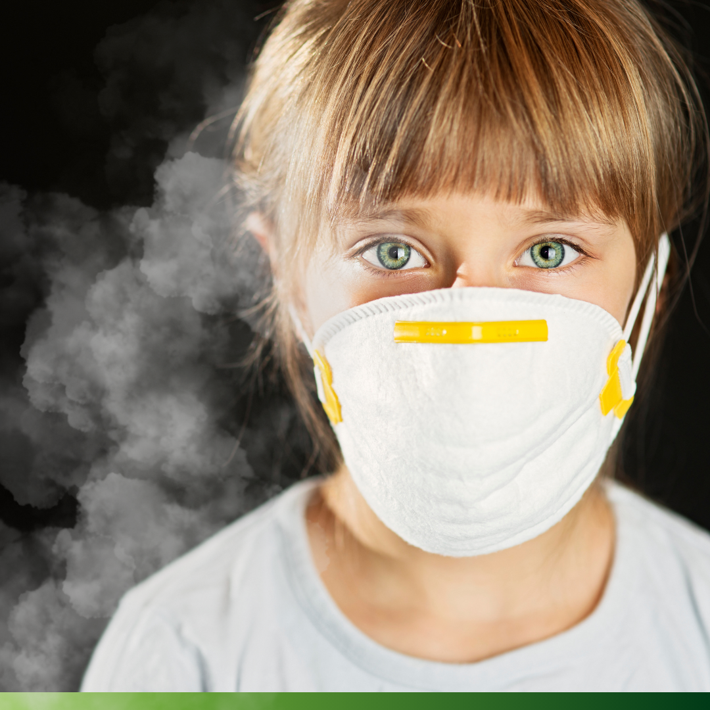

## Garantindo a Qualidade do Ar Interior: Entenda as Regulamentações em Vigor

A qualidade do ar interior é um elemento crucial para garantir ambientes saudáveis em edifícios comerciais e de serviços. O Decreto-Lei n.º 101-D/2020, de 7 de dezembro, estabelece requisitos rigorosos para assegurar que todos os edifícios em funcionamento cumpram padrões de qualidade do ar.

De acordo com este decreto, todos os edifícios de comércio e serviços devem atender aos limiares de proteção e condições de referência estabelecidos. Além disso, grandes edifícios e aqueles que incluem creches, estabelecimentos de educação e estruturas residenciais para idosos estão sujeitos a avaliações simplificadas anuais para verificar o cumprimento dos requisitos de qualidade do ar interior.

Os requisitos incluem a ventilação adequada dos espaços, garantindo uma filtragem eficaz e a renovação adequada do ar. Além disso, proprietários e gestores de edifícios são responsáveis por solicitar verificações de conformidade às entidades competentes, assegurando que os resultados das avaliações sejam adequadamente analisados e quaisquer desconformidades sejam corrigidas.

A Portaria n.º 138-G/2021, de 1 de julho, complementa o Decreto-Lei estabelecendo disposições adicionais sobre a qualidade do ar interior. Esta portaria aborda questões como a avaliação da qualidade do ar, limiares de proteção, critérios de conformidade e metodologias de medição de poluentes.

É importante destacar que o Despacho n.º 1618/2022 estabelece prazos específicos para a realização das avaliações de qualidade do ar interior.

Garantir a qualidade do ar interior é fundamental para promover a saúde e o bem-estar dos ocupantes de edifícios comerciais e de serviços. Cumprir estas regulamentações não só é uma obrigação legal, mas também demonstra um compromisso com a segurança e o conforto dos utilizadores do edifício.

Para mais informações sobre como garantir a qualidade do ar interior no seu edifício e cumprir todas as regulamentações aplicáveis, consulte os diplomas legais relevantes: Decreto-Lei n.º 101-D/2020, Portaria n.º 138-G/2021 e Despacho n.º 1618/2022. Estamos aqui para ajudar a garantir que o seu espaço proporcione um ambiente saudável e seguro para todos.

A AnambConsul está aqui para o ajudar a cumprir todas as exigências legais e garantir a qualidade do ar interior nos edifícios de comércio e serviços.

Entre em contacto connosco para obter mais informações e assegure a saúde e bem-estar dos seus ocupantes.

Em Portugal, o **Decreto-Lei n.º 101-D/2020** estabelece um conjunto de requisitos relacionados com a **qualidade do ar interior** em edifícios de comércio e serviços, aplicáveis tanto a novos edifícios como aos já em funcionamento. Esta legislação visa garantir que os espaços cumprem limiares de proteção e condições de referência, com uma atenção especial a estabelecimentos que servem grupos sensíveis, como creches, escolas de ensino básico e residências para idosos.

## Requisitos de Qualidade do Ar para Edifícios Comerciais e de Serviços

### 1. Ventilação e Renovação do Ar

Todos os edifícios novos ou renovados, bem como os respetivos sistemas técnicos, devem ser projetados para assegurar uma ventilação eficaz, proporcionando filtragem e renovação adequadas do ar nos espaços interiores.

### 2. Monitorização Contínua da Qualidade do Ar

Todos os edifícios comerciais e de serviços em funcionamento devem assegurar o cumprimento dos limiares de proteção definidos, com referência aos níveis de poluentes e outros parâmetros que afetam a qualidade do ar.

### 3. Avaliação Simplificada Anual para Edifícios Críticos

Os **Grandes Edifícios de Comércio e Serviços (GES)** e outros edifícios que acomodem públicos sensíveis (como creches e escolas de ensino básico) estão sujeitos a uma **avaliação simplificada anual**. Esta avaliação é essencial para detetar eventuais problemas relacionados com a qualidade do ar.

### 4. Verificação e Conformidade

Após a avaliação, os proprietários devem solicitar às autoridades competentes a verificação da conformidade dos resultados, permitindo a identificação de qualquer desconformidade em relação aos limiares de qualidade do ar.

### 5. Gestão de Não-Conformidades

Em caso de desconformidades, os proprietários estão obrigados a adotar as medidas corretivas necessárias, conforme indicado num relatório de verificação. O registo atualizado destas ações deve estar disponível para inspeção pelas autoridades.

## Regulamentação Adicional – Portaria n.º 138-G/2021

A **Portaria n.º 138-G/2021**, de 1 de julho, complementa o Decreto-Lei n.º 101-D/2020, estabelecendo:

- Critérios de avaliação e registo dos parâmetros de qualidade do ar interior em edifícios de comércio e serviços.
- Limiar de proteção e condições de referência, bem como critérios de conformidade específicos.
- Metodologias para a medição de poluentes e procedimentos de fiscalização.

## Prazos e Obrigações – Despacho n.º 1618/2022

O **Despacho n.º 1618/2022**, de 9 de fevereiro, fixa um prazo de 180 dias, a partir da entrada em vigor do despacho, para que todos os edifícios abrangidos realizem a avaliação obrigatória da qualidade do ar. Este prazo terminou a 8 de agosto de 2022, e os edifícios que ainda não cumpriram estão em incumprimento legal, com sanções associadas.

## Porque é Essencial Cumprir com os Requisitos de Qualidade do Ar?

A **qualidade do ar interior** é crucial para a saúde e o bem-estar dos ocupantes de qualquer espaço. Poluentes e má ventilação em espaços fechados podem causar uma variedade de problemas de saúde, incluindo problemas respiratórios, alergias e até agravamento de doenças crónicas. Para edifícios que servem populações vulneráveis, como crianças e idosos, a monitorização e manutenção da qualidade do ar são ainda mais cruciais.

A **Anambconsul** oferece serviços especializados para ajudar as empresas a cumprir estes requisitos legais e a implementar sistemas eficazes de controlo e monitorização da qualidade do ar. Com uma equipa qualificada, fornecemos suporte em todas as etapas do processo, incluindo:

- **Avaliação da Qualidade do Ar**;
- **Verificação de conformidade** com os parâmetros legais;
- **Implementação de sistemas de ventilação e filtragem** adequados.

Cumprir com as normas de qualidade do ar é fundamental para assegurar a segurança e saúde dos ocupantes e evitar penalizações.

## Contacte-nos para Consultoria Especializada

Para garantir que o seu edifício cumpre todos os requisitos legais de qualidade do ar e assegurar o conforto e saúde dos ocupantes, contacte a **Anambconsul**.

- 📞 Telefone: [252 378 031](tel:+351252378031)
- 🏆 Top Scoring 5% pelo 5º ano consecutivo
- 📜 Certificação ISO 9001
