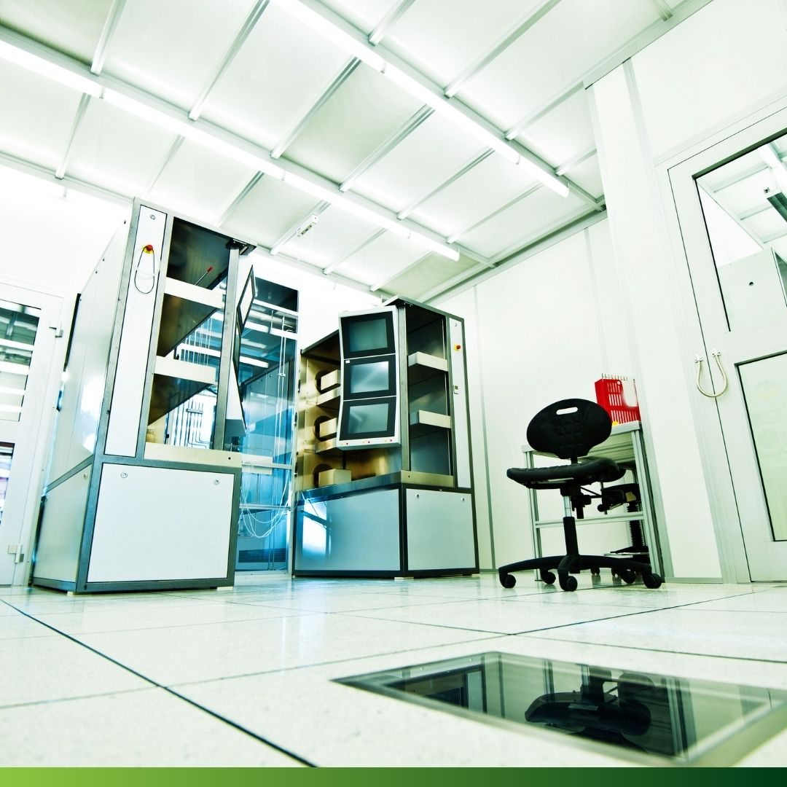

## Explorando o Mundo das Salas Limpas: Conheça o Papel Vital da Anambconsul

As salas limpas desempenham um papel fundamental em várias indústrias, desde a saúde até à eletrónica. Estes ambientes altamente controlados são projetados para minimizar a presença de contaminantes, garantindo assim a integridade de processos críticos.

A Anambconsul é um protagonista nesse cenário, oferecendo classificações de salas limpas de acordo com os mais altos padrões da norma ISO 14644.

A ISO 14644-1:2015 estabelece uma estrutura clara para classificar a limpeza do ar em salas limpas, baseando-se na contagem de partículas por tamanho.

Este método é essencial para garantir que os ambientes críticos atendam aos requisitos específicos de cada setor.

A Anambconsul utiliza equipamentos de leitura direta para realizar avaliações precisas da qualidade do ar em salas limpas.

Este processo é crucial para determinar a conformidade com as normas da ISO e para garantir a eficácia das medidas de controlo de contaminação.

As áreas de atuação da Anambconsul abrangem uma ampla gama de setores, incluindo saúde e eletrónica. Nos hospitais, a classificação de salas limpas desempenha um papel vital na redução de riscos relacionados com contaminações, garantindo ambientes seguros para pacientes e profissionais de saúde. Na indústria eletrónica, a classificação de salas é fundamental para manter ambientes controlados que suportam processos de produção altamente sensíveis.

Dispomos de uma equipa técnica especializada para a monitorização e avaliação dos parâmetros físicos, químicos e biológicos:

- Partículas em suspensão (fração PM0,3), [μg/m³];
- Partículas em suspensão (fração PM0,5), [μg/m³];
- Partículas em suspensão (fração PM1), [μg/m³];
- Medição de caudais e renovações de ar;
- Determinar as condições de pressão das salas;
- Pressão diferencial para verificação da condição de subpressão ou sobrepressão das salas;
- Contagem de Bactérias no ar, [UFC/m³];
- Contagem de Fungos no ar, [UFC/m³].

Estas instalações desempenham um papel crucial em várias áreas, garantindo a integridade de processos críticos e a segurança de produtos e pessoas.

As salas limpas são um exemplo impressionante de como a tecnologia e a inovação podem criar ambientes altamente controlados para atender às necessidades específicas de cada setor.

Para saber mais sobre os serviços de classificação de salas limpas oferecidos pela Anambconsul e como podem beneficiar a sua empresa, entre em contacto hoje mesmo.

Estamos aqui para ajudar a garantir que o seu ambiente de trabalho atenda aos mais altos padrões de qualidade e segurança.
