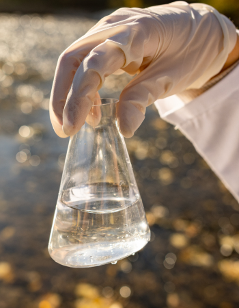
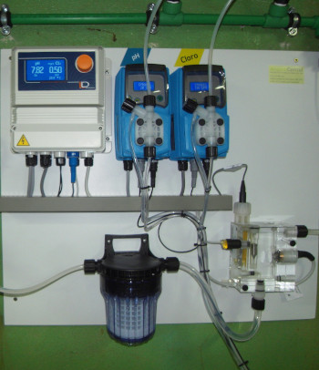
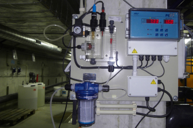
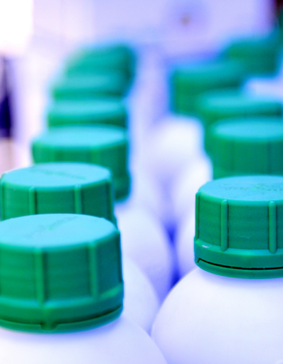

## Importância do Tratamento de Águas

A água é um elemento vital para a vida no nosso planeta. Desde o consumo humano até ao uso industrial e agrícola, a sua salubridade é fundamental para a saúde humana, a preservação do meio ambiente e o desenvolvimento sustentável. O controlo analítico da água garante que a água tenha os mais altos padrões de salubridade e segurança.

Na AnambConsul, entendemos a importância do controlo analítico da água.

Com a nossa experiência e especialização, oferecemos serviços de análise de água abrangentes e precisos, ajudando empresas e comunidades a garantir a salubridade e segurança dos seus recursos hídricos.

## Tratamento de Águas para Consumo Humano

Tendo em conta as diferentes origens que uma água de consumo humano pode ter, bem como a sua natureza biológica é necessário garantir sempre a sua qualidade e salubridade.

Conforme a necessidade específica de cada cliente realizamos os seguintes trabalhos:

- Sistemas de tratamento específicos para remoção de parâmetros químicos (Ferro, Manganês, Arsénio, entre outros)
- Sistemas de desinfeção à base de produtos clorados, osmose inversa, ultravioleta, entre outros
- Instalação e manutenção preventiva dos diversos equipamentos e componentes dos sistemas de tratamento
- Controlo analítico local e laboratorial, recorrendo a laboratórios acreditados para os parâmetros em avaliação
- Desinfeção e higienização de reservatórios de água para consumo humano

## Tratamento de Águas para Piscinas

A água das piscinas é simultaneamente convidativa e revitalizante, mas também suscetível a contaminação externa, seja por parte dos banhistas, elementos atmosféricos ou pelo uso inadequado de produtos químicos na sua manutenção.

A AnambConsul possui o conhecimento técnico necessário para o dimensionamento, manutenção e tratamento adequado de piscinas. Entre os nossos serviços destacam-se:

- Remoção, limpeza e substituição de meios filtrantes.
- Fornecimento, instalação e manutenção de equipamentos, como controladores, bombas doseadoras, sondas, pré-filtros, filtros, entre outros.
- Realização de controlo analítico local e laboratorial em conformidade com a legislação, em laboratórios credenciados.
- Prestação de apoio técnico especializado.

Estamos prontos para garantir que a sua piscina ofereça sempre um ambiente seguro e saudável para desfrutar.

## Produtos Químicos

A AnambConsul dispõe de uma diversidade de produtos para tratamento de águas para piscina e consumo humano, entre eles:

- Hipoclorito de Sódio
- Floculante
- Incrementador de pH
- Tricloro
- Dicloro
- Bromo
- Algicida
- Minorador de pH
- Sal
- Entre outros

